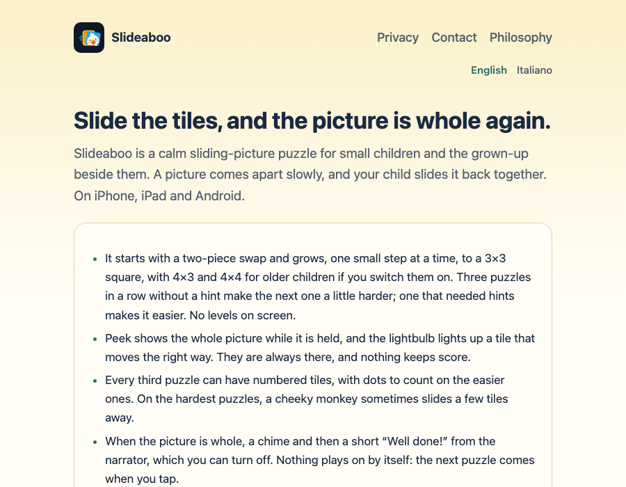
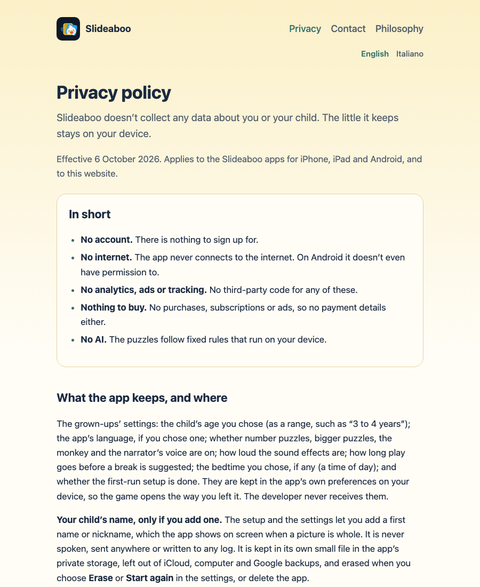
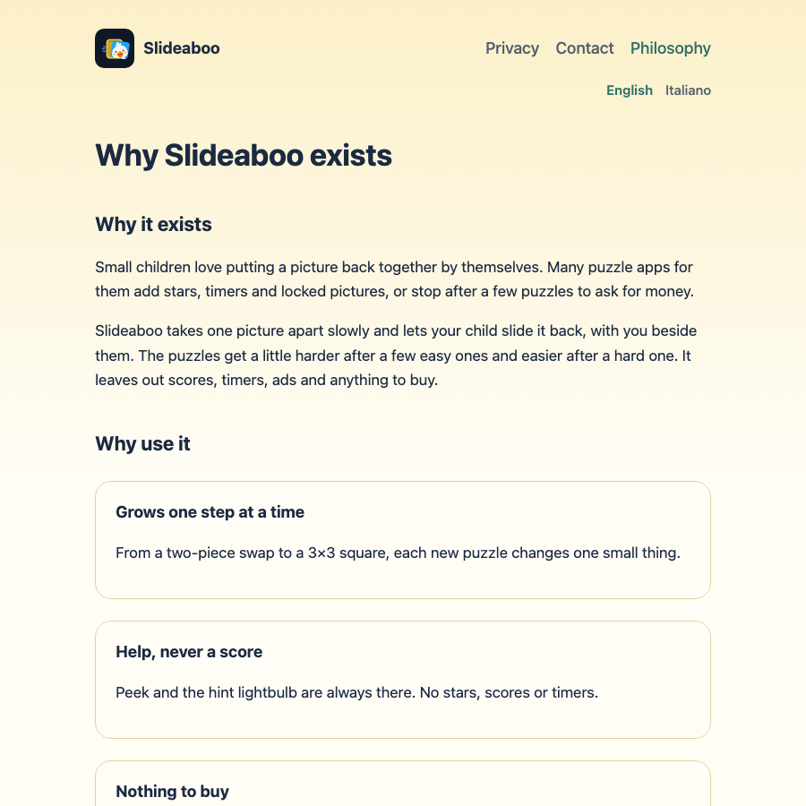
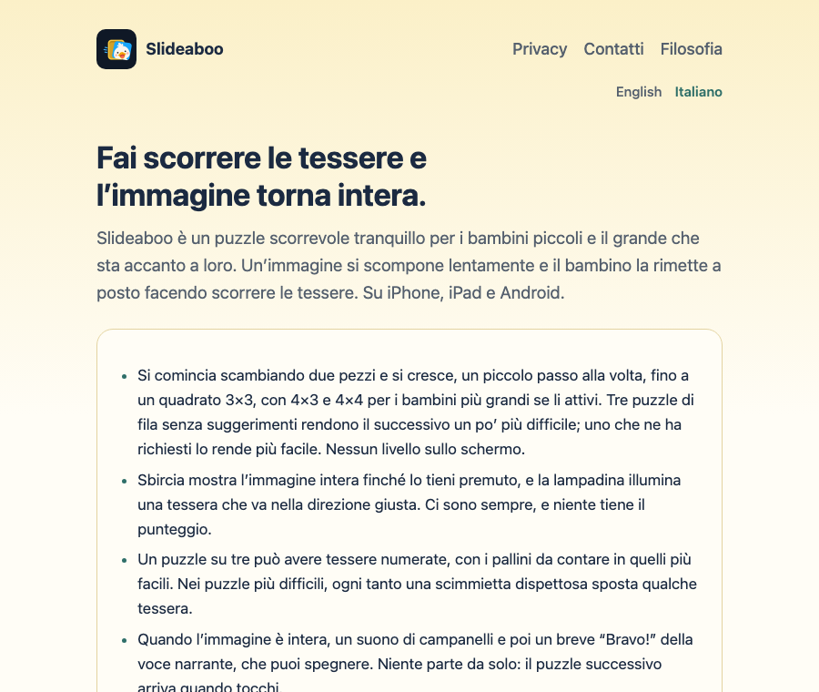
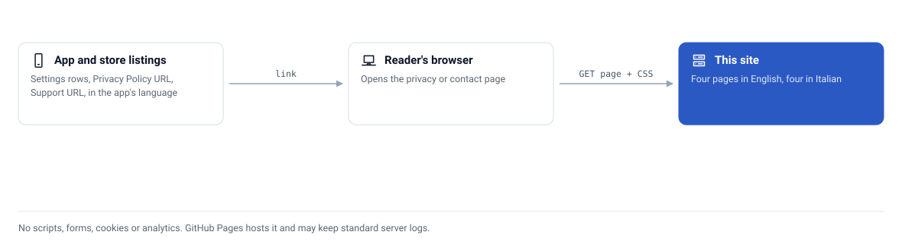

<div align="center">


# 🧩 Slideaboo site

**Read what the Slideaboo toddler puzzle app keeps, and where, before you install it: privacy policy, support and philosophy pages in English and Italian**


[](https://github.com/CaputoDavide93/slideaboo-site/actions/workflows/ci.yml)

</div>

---

## ✨ Features

This repository is the public website for **Slideaboo**, a calm sliding-picture
puzzle for small children and the grown-up beside them, on iPhone, iPad and
Android. App stores need a privacy policy and a support page, and the app links
to both. This site is where they live. Open it at
[caputodavide93.github.io/slideaboo-site](https://caputodavide93.github.io/slideaboo-site/).

### Why it exists

An app for a two-year-old asks a parent for trust. Before you install it you
want to know what it keeps about your child, which permissions it asks for and
whether anything leaves the device. The answer has to sit on a page you can read
on your phone, without a cookie banner, in your own language, and the stores
want the same page as a link.

So the policy is a plain static page, in English and Italian. It says what stays
on the device, that the app asks for no permissions, how the optional child's
name is stored and erased, and how to delete everything.

| | This site | A policy page on a generic site builder | A policy PDF |
|---|---|---|---|
| Scripts, cookies, analytics | None (a check fails the build if a script or form appears) | Often present | None |
| Readable on a phone | Yes, one column | Depends on the theme | Pinch and zoom |
| Light and dark | Follows the reader's system setting | Depends on the theme | No |
| English and Italian, linked to each other | Yes, with `hreflang` tags | Usually a plugin | One file per language |
| Stable URLs the stores can keep | `/privacy/` and `/contact/`, plus `/it/...` | Tied to the builder | Tied to a file name |
| Review the change before it goes live | Pull request, then GitHub Pages publishes `main` | Edit in a web editor | Replace the file |

The trade-off: only English and Italian exist, and GitHub Pages may keep
standard server logs for visitors. Both are stated on the site.

### Install in 3 steps

There is nothing to install to read the site. To preview or edit it you need
Python 3 and a browser.

1. **Clone:** `git clone https://github.com/CaputoDavide93/slideaboo-site.git && cd slideaboo-site`
2. **Serve:** `make serve` (the same as `python3 -m http.server 8000`).
3. **Open** <http://localhost:8000/>. Run `make check` before you push.

### What you get

| | Page | What it is |
|---|---|---|
| 🏠 | [Home](https://caputodavide93.github.io/slideaboo-site/) | What the app is, in a few lines |
| 🔒 | [Privacy policy](https://caputodavide93.github.io/slideaboo-site/privacy/) | What the app keeps on the device (the grown-ups' settings only), permissions (none), links, payments (none), children. Linked from the app's settings and the store listings |
| ✉️ | [Contact](https://caputodavide93.github.io/slideaboo-site/contact/) | Support address and common questions. Linked from the app's settings and the store listings |
| 🌱 | [Philosophy](https://caputodavide93.github.io/slideaboo-site/philosophy/) | Why the app exists: the app's own "Why" screen, word for word |
| 🌍 | English and Italian | Each page in both languages (`it/`), linked to each other. The app opens the Italian privacy and contact pages when it runs in Italian, and the English ones otherwise |
| 🌗 | Light and dark | Follows the reader's system setting, in the app's own colours |
| 🚫 | No tracking | No scripts, forms, cookies or analytics, and a check that fails if one appears |
| 🔎 | Findable | Canonical URLs, `hreflang` alternates, a sitemap, `robots.txt` and `llms.txt` |
| 🧪 | Self-checking | `make check` verifies every page exists, every local link resolves, metadata is present and the support address is the only one |

---

## 📸 Screenshots

Taken from the served site by `make screenshots` (Chromium, 900 px wide). The
contact page is left out because it shows the support address.

<table>
<tr>
<td width="50%">
<picture>
  <source media="(prefers-color-scheme: dark)" srcset="docs/assets/screenshots/home-dark.png">
  
</picture>
</td>
<td width="50%">
<picture>
  <source media="(prefers-color-scheme: dark)" srcset="docs/assets/screenshots/privacy-dark.png">
  
</picture>
</td>
</tr>
<tr>
<td width="50%">
<picture>
  <source media="(prefers-color-scheme: dark)" srcset="docs/assets/screenshots/philosophy-dark.png">
  
</picture>
</td>
<td width="50%">
<picture>
  <source media="(prefers-color-scheme: dark)" srcset="docs/assets/screenshots/home-it-dark.png">
  
</picture>
</td>
</tr>
</table>

---

## 🗺️ Architecture

<picture>
  <source media="(prefers-color-scheme: dark)" srcset="docs/assets/architecture-dark.svg">
  
</picture>

How it is built is in [docs/how-it-works.md](docs/how-it-works.md).

---

## 🚀 Quick Start

```bash
make serve     # preview at http://localhost:8000
make check     # page, link, metadata and diagram checks, the same as CI
```

GitHub Pages publishes the `main` branch root, so a merged pull request is the
release. The privacy pages must stay true to the app's own `docs/privacy.md`:
change both together, in both languages, with a new effective date. Settings
labels are quoted from the app's ARB files (`lib/l10n/app_*.arb`), and the
philosophy pages are its `whyTitle` to `whyClosing` copy, in the order the
screen shows it. More in [docs/setup.md](docs/setup.md).

---

## 🧪 Tested on

| Environment | Status |
|---|---|
| Chromium (Playwright 1.64.1) on macOS, light and dark | ✅ Screenshots and layout checked |
| `make check` on Python 3.12 (CI, Ubuntu) | ✅ Runs on every pull request |
| Safari and Firefox | ❔ Unverified: plain HTML and CSS, not tried here |
| Screen readers | ❔ Unverified |

---

## 📁 Repo structure

```text
slideaboo-site/
├── index.html             # 🏠 home
├── privacy/index.html     # 🔒 privacy policy
├── contact/index.html     # ✉️ contact and support
├── philosophy/index.html  # 🌱 why the app exists
├── it/                    # 🇮🇹 the same four pages in Italian
├── assets/                # 🎨 site.css and the app icon in three sizes
├── docs/                  # 📚 setup, how it works, FAQ, troubleshooting
│   └── assets/            # 🖼️ diagram, screenshots, social preview
├── tools/                 # 🔧 check_site.py, gen_diagram.py, brand/, screenshots/
├── .github/workflows/     # 🤖 ci.yml runs make check
├── Makefile               # ⚙️ check, serve, diagram, screenshots, social
├── llms.txt               # 🤖 the site in one plain-text page for search tools
├── robots.txt  sitemap.xml  # 🔎 crawler files
├── AGENTS.md  CLAUDE.md   # 🧭 contributor notes
├── CONTRIBUTING.md  SECURITY.md  LICENSE
├── .nojekyll              # serve files as they are
└── .gitignore
```

---

## 🛠️ Troubleshooting

[docs/troubleshooting.md](docs/troubleshooting.md) lists symptoms and fixes:
a page that 404s on GitHub Pages, a failing `make check`. Common questions are
in [docs/faq.md](docs/faq.md). The full index is [docs/README.md](docs/README.md).

---

## 🔒 Security

See [SECURITY.md](SECURITY.md).

---

## 🤝 Contributing

Found a wrong sentence, a broken link or a page that reads badly on your
device? [Open an issue](https://github.com/CaputoDavide93/slideaboo-site/issues/new)
with the page address, your browser and operating system with versions, and a
screenshot if it is a layout problem. Reports from browsers and devices not
listed under Tested on are especially useful. Details are in
[CONTRIBUTING.md](CONTRIBUTING.md).

---

## 📄 License

[MIT](LICENSE)

---

<p align="center"><sub>Made with ❤️ by <a href="https://github.com/CaputoDavide93">Davide Caputo</a></sub></p>
